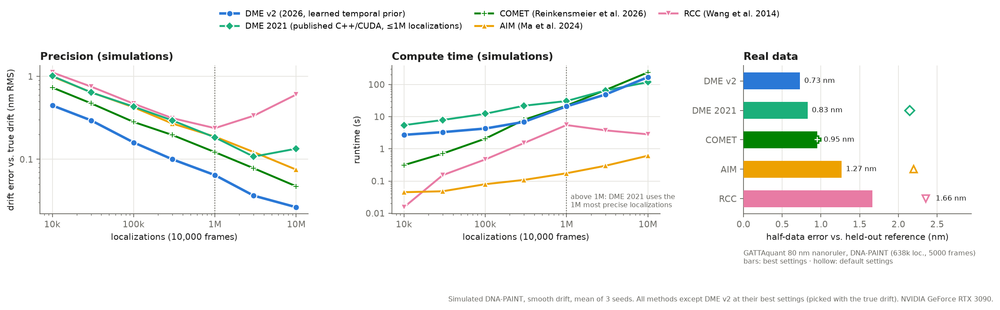

DME: drift correction for localization microscopy by entropy minimization
==========================================================================

Fiducial-free drift estimation for single-molecule localization microscopy (2D and 3D), from the localizations alone.

J. Cnossen, T. J. Cui, C. Joo, C. Smith, "Drift correction in localization microscopy using entropy minimization",
[Opt. Express 29, 27961 (2021)](https://opg.optica.org/oe/fulltext.cfm?uri=oe-29-18-27961&id=457245).

**DME v2 (2026)** is a rewrite in PyTorch: no compilation, runs on any CUDA GPU (Linux, Windows) or on the CPU. It
maximizes the same entropy objective as the paper, and adds a small learned temporal prior: instead of a spline with a
user-chosen number of frames per knot, it measures the drift of short time segments with the DME objective and turns
these measurements into a drift trace with a trained 1D network. It chooses the temporal resolution itself, so it has
no settings to tune. How it works: [docs/method.md](docs/method.md).



On simulated DNA-PAINT data DME v2 is 1.6–2.1× more precise than COMET, the next best method, and 2–5× more precise
than AIM, RCC and the 2021 DME code, although each of those was run at its best settings, picked with the true drift
(DME v2 has no settings). On a real DNA-PAINT nanoruler (the dataset in `example_data/`) it is also the most precise.
It is slower than AIM and RCC: 3 s for 10k localizations, 20 s for 1M, 3 minutes for 10M on an RTX 3090.
Details, tables and the settings searched: [docs/comparison.md](docs/comparison.md).

Installation
------------

```
pip install git+https://github.com/qnano/drift-estimation.git
```

This needs PyTorch. For GPU support, install the CUDA build of PyTorch first, see [pytorch.org](https://pytorch.org).
Optionally, install CuPy (`pip install cupy-cuda12x`, matching your CUDA version) for faster exact pair kernels.

Usage
-----

```python
from dme import dme_estimate

# positions: [N, 2] or [N, 3] (e.g. x, y in pixels, z in microns), framenum: [N], crlb: [N, D] localization precision
drift, (drift_set1, drift_set2) = dme_estimate(positions, framenum, crlb)
corrected = positions - drift[framenum]
```

- `dme_estimate(positions, framenum, crlb)`: DME v2, temporal resolution chosen automatically, learned prior.
- `framesperbin=100`: DME v2 with a fixed cubic spline (one knot per 100 frames), no learned prior. Much faster
  (0.2–3 s), but you choose the temporal resolution.
- `method='v1', framesperbin=100`: the algorithm of the 2021 paper (exact pairwise objective, RCC start), on the GPU.
  Supports per-localization CRLBs (`perSpotCRLB=True`).
- `drift_set1`/`drift_set2` are estimates from two halves of the data; `dme.precision(drift_set1, drift_set2)` gives
  their RMS difference as an indication of the precision. Disable with `estimatePrecision=False`.

Examples: [dme_example.py](dme_example.py) (3D simulation), [dme_example_picasso_hdf5.py](dme_example_picasso_hdf5.py)
(Picasso HDF5 file), [Google Colab](https://colab.research.google.com/github/qnano/drift-estimation/blob/master/dme_example_colab.ipynb).

MATLAB
------

[matlab/dme_estimate_v2.m](matlab/dme_estimate_v2.m) calls the Python package through MATLAB's Python interface
(R2022a or newer), so MATLAB gets exactly the same DME v2, on the GPU. Point MATLAB once to a Python environment with
PyTorch and this package:

```matlab
pyenv('Version', 'C:\path	o\env\python.exe', 'ExecutionMode', 'OutOfProcess')
addpath('matlab')
[drift, set1, set2] = dme_estimate_v2(positions, framenum, crlb);      % framenum starts at 0
corrected = positions - drift(framenum + 1, :);
```

Options: `'FramesPerBin'` (fixed bins), `'Method', 'v1'`, `'EstimatePrecision'`, `'Device'`. Example:
[dme_example_v2.m](dme_example_v2.m). The original MATLAB wrapper of the 2021 C++/CUDA code is still in `matlab/`
(`dme_estimate.m`, [dme_example.m](dme_example.m)).

Repository
----------

| path | contents |
|---|---|
| `dme/` | the package: `dme_estimate`; `dme_prior.py` learned prior; `dme_grid.py` density-grid DME; `dme_pipeline.py` v1 and RCC; `aim_torch.py` AIM |
| `dme/weights/` | weights of the learned temporal prior |
| `docs/` | [method.md](docs/method.md), [comparison.md](docs/comparison.md), figures |
| `benchmark/` | the comparison: scripts and results |
| `training/` | training of the temporal prior (synthetic data only) |
| `tests/` | `python -m pytest tests` |
| `matlab/` | `dme_estimate_v2.m` (DME v2 from MATLAB); the other files wrap the 2021 C++/CUDA code |
| `dme/DME`, `CMakeLists.txt` | the original 2021 C++/CUDA implementation |

Original C++/CUDA version
-------------------------

The 2021 implementation is still available as `dme.legacy.dme_estimate` (and its MATLAB wrapper `matlab/dme_estimate.m`).
It needs the compiled library: run `build_windows.bat` on Windows, or `cmake . && make` on Linux with CUDA installed.
Known problems of that code, absent in the PyTorch versions: its neighbor list is not updated often enough, so it
can stop before reaching the optimum, and above a few million localizations an integer overflow makes it return zero
drift. Its `maxspots` option kept the least precise localizations instead of the most precise; this is fixed.
