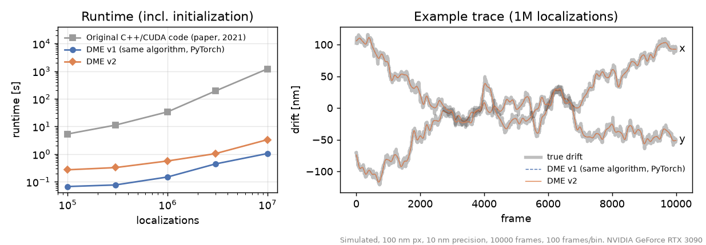

DME: drift correction for localization microscopy by entropy minimization
==========================================================================

Code for J. Cnossen, T. J. Cui, C. Joo, C. Smith, "Drift correction in localization microscopy using entropy minimization",
[Opt. Express 29, 27961 (2021)](https://opg.optica.org/oe/fulltext.cfm?uri=oe-29-18-27961&id=457245).

**Version 2 (2026)** is a rewrite in PyTorch. It needs no compilation, runs on any CUDA GPU (Linux, Windows; CPU fallback),
and is 20–1000× faster than the original C++/CUDA code (10M localizations: 1–3 s instead of 20 minutes):

- `method='v2'` (default): the same entropy objective, evaluated on a blurred density grid (or with exact pair sums
  when the data is sparse), a coarse-to-fine schedule and a preconditioned L-BFGS optimizer. It starts from several
  initial estimates (intersection tracking as in [AIM](https://github.com/YangLiuLab/AIM), RCC, and zero drift) and
  continues with the one with the best DME score.
- `method='v1'`: the algorithm of the paper and the original C++/CUDA code (exact pairwise objective, RCC
  initialization), reimplemented in PyTorch. The neighbor search runs on the GPU with a spatial hash instead of a CPU
  KD-tree.



v1 and v2 find the same drift. On these simulations v1 is 2–4× faster, because v2 tries three initial estimates.
On denser real data v2 is usually faster: on 8 DNA-PAINT datasets (3.2–5.8M localizations), v2 takes 0.9–1.6 s and
v1 0.6–3.5 s, both at 0.03–0.047 px split-half precision. On a 26M-localization simulation with a 2048² px field of
view, v2 takes 10.9 s and v1 11.9 s.

Two bugs in the original implementation are gone in both versions. Its neighbor list was not updated often enough,
so it could stop before reaching the optimum. On datasets with more than a few million
localizations, an integer overflow could make it silently return zero drift. The figure is made by
`docs/readme_plots.py`.

Installation
------------

```
pip install git+https://github.com/qnano/drift-estimation.git
```

This needs PyTorch. For GPU support, install the CUDA build of PyTorch first, see [pytorch.org](https://pytorch.org).
Optionally, install CuPy (`pip install cupy-cuda12x`, matching your CUDA version) for faster exact pair kernels.
Without CuPy, a pure PyTorch version of those kernels is used, which needs more memory.

Usage
-----

```python
from dme import dme_estimate

# positions: [N, 2] or [N, 3] (e.g. x, y in pixels, z in microns), framenum: [N], crlb: [N, D] localization precision
drift, (drift_set1, drift_set2) = dme_estimate(positions, framenum, crlb, framesperbin=100)
corrected = positions - drift[framenum]

# algorithm of the paper (also supports per-spot CRLB: perSpotCRLB=True)
drift, _ = dme_estimate(positions, framenum, crlb, framesperbin=100, method='v1')
```

`framesperbin` sets the temporal resolution: drift is modeled as a cubic spline with one knot every `framesperbin` frames.
`drift_set1`/`drift_set2` are estimates from two halves of the data. Their difference indicates the precision
(`dme.precision(drift_set1, drift_set2)`); disable this with `estimatePrecision=False`.

Examples: [dme_example.py](dme_example.py) (3D simulation), [dme_example_picasso_hdf5.py](dme_example_picasso_hdf5.py)
(Picasso HDF5 file), [Google Colab](https://colab.research.google.com/github/qnano/drift-estimation/blob/master/dme_example_colab.ipynb).

Original C++/CUDA version
-------------------------

The 2021 implementation is still available as `dme.legacy.dme_estimate` (and the MATLAB wrapper in `matlab/`).
It needs the compiled library: run `build_windows.bat` on Windows, or `cmake . && make` on Linux with CUDA installed.
