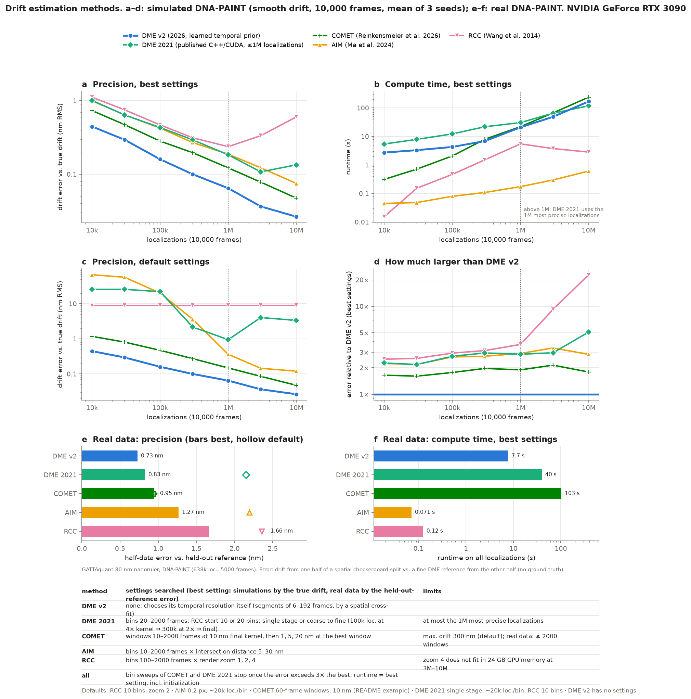
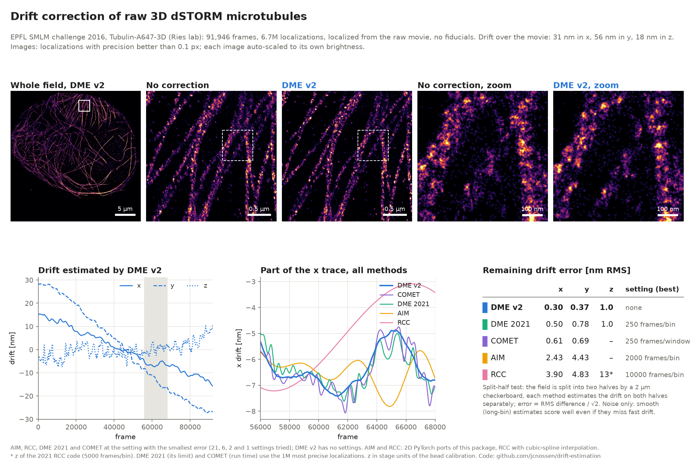

# Comparison of drift estimation methods

DME v2 compared with the 2021 DME code and with the other fiducial-free methods we know of: COMET, AIM and RCC.
Every method except DME v2 was tuned: it was run over a grid of its settings and is shown at its best one. Scripts and
raw results are in [`benchmark/`](../benchmark); all runs on one NVIDIA RTX 3090.



## Methods

| method | implementation | settings searched | limits |
|---|---|---|---|
| **DME v2** | `dme_estimate(...)` (this package) | none: chooses its temporal resolution itself | |
| DME 2021 | original C++/CUDA code, [qnano/drift-estimation@2ee39f7](https://github.com/qnano/drift-estimation/tree/2ee39f7) | bins 20–2000 frames; RCC start with 10 or 20 bins; single stage, or coarse to fine (100k localizations at 4× kernel and 4× longer bins → 300k at 2× → final) | at most the 1M most precise localizations |
| COMET | `comet-smlm` 1.2.0 (Reinkensmeier et al., bioRxiv 2026), numba-cuda backend | windows 10–2000 frames at 10 nm final kernel, then 1, 5, 20 nm at the best window | max. drift 300 nm (default); real data: ≤ 2000 windows |
| AIM | PyTorch port of AIM (Ma et al., Sci. Adv. 2024) in `dme.aim` | bins 10–2000 frames × intersection distance 5–30 nm | |
| RCC | PyTorch/GPU redundant cross-correlation (Wang et al. 2014) in `dme.rcc_torch` | bins 100–2000 frames × render zoom 1, 2, 4 | zoom 4 does not fit in 24 GB GPU memory at 3M–10M localizations |

For the slow methods (COMET, DME 2021) the bin-length sweep stops once the error exceeds 3× the best so far. The
runtime shown is that of the best setting, including initialization. "Default settings" are what a user would start
with: RCC with 10 bins at zoom 2; AIM with ~20k localizations per bin and its 0.2 px intersection distance; COMET as in
its README example (60-frame windows, 10 nm); DME 2021 single stage with ~20k localizations per bin and a 10-bin RCC
start. DME v2 has no settings.

AIM and RCC are our GPU implementations, not the original code (AIM's is MATLAB). COMET and DME 2021 are the
published code.

## Simulations

DNA-PAINT-like data: binding sites at constant density (0.02 per px²), ~200 localizations per site at random frames,
10,000 frames, 100 nm pixels, localization precision varying per localization (log-normal photon count, 5–13 nm,
mean ≈ 9 nm). Smooth drift: linear plus two slow sinusoids (±60 nm). 10k to 10M localizations, 3 seeds each. Error =
RMS difference between the estimated and the true drift (2D, nm, mean over seeds); for the tuned methods the best
setting per dataset is picked with the true drift, an advantage no user has.

**Best settings**: drift error (nm) · runtime (s)

| method | 10k | 30k | 100k | 300k | 1M | 3M | 10M |
|---|---|---|---|---|---|---|---|
| **DME v2** | **0.45** · 2.7 | **0.30** · 3.3 | **0.16** · 4.3 | **0.10** · 6.9 | **0.064** · 21 | **0.036** · 49 | **0.026** · 168 |
| COMET | 0.74 · 0.31 | 0.47 · 0.71 | 0.28 · 2.1 | 0.20 · 8.0 | 0.12 · 22 | 0.078 · 67 | 0.047 · 237 |
| DME 2021 | 1.01 · 5.4 | 0.64 · 7.9 | 0.43 · 12 | 0.29 · 22 | 0.18 · 31 | 0.11 · 65 | 0.13 · 118 |
| AIM | 1.00 · 0.04 | 0.64 · 0.05 | 0.42 · 0.08 | 0.27 · 0.11 | 0.19 · 0.17 | 0.12 · 0.30 | 0.075 · 0.61 |
| RCC | 1.12 · 0.02 | 0.75 · 0.15 | 0.47 · 0.47 | 0.31 · 1.5 | 0.24 · 5.5 | 0.34 · 3.8 | 0.60 · 2.8 |

**Default settings**: drift error (nm) · runtime (s)

| method | 10k | 30k | 100k | 300k | 1M | 3M | 10M |
|---|---|---|---|---|---|---|---|
| **DME v2** | **0.45** · 2.7 | **0.30** · 3.3 | **0.16** · 4.3 | **0.10** · 6.9 | **0.064** · 21 | **0.036** · 49 | **0.026** · 168 |
| COMET | 1.18 · 0.29 | 0.81 · 0.79 | 0.47 · 2.3 | 0.27 · 7.0 | 0.15 · 25 | 0.085 · 79 | 0.047 · 260 |
| DME 2021 | 25.8 · 2.3 | 25.8 · 2.9 | 22.1 · 4.0 | 2.18 · 17 | 0.95 · 103 | 4.05 · 64 | 3.34 · 115 |
| AIM | 67.1 · 0.01 | 57.0 · 0.01 | 20.1 · 0.01 | 3.62 · 0.03 | 0.36 · 0.09 | 0.15 · 0.26 | 0.12 · 0.76 |
| RCC | 8.9 · 0.00 | 8.9 · 0.00 | 9.0 · 0.00 | 9.0 · 0.01 | 9.0 · 0.02 | 9.0 · 0.05 | 9.0 · 0.15 |

- DME v2 is 1.6–2.1× more precise than COMET at every size, 2.2–3.4× more precise than AIM, 2.2–5× more precise
  than DME 2021 and 2.5–23× more precise than RCC.
- Run coarse to fine, DME 2021 is 3× faster than in a single stage at 1M localizations; above 1M it is limited by the
  1M-localization subset.
- AIM is by far the fastest, and with tuned settings about as precise as DME 2021.
- With default settings, the bin length of AIM, RCC and DME 2021 is wrong for most dataset sizes: errors of 9–67 nm on
  small datasets. COMET's README settings hold up well (about 1.5× its tuned error).

## Real data

The GATTAquant 80 nm DNA-PAINT nanoruler in `example_data/` (638k localizations, 5000 frames, 108.3 nm pixels). There
is no true drift, so the error is measured by a held-out comparison: the localizations are split into two halves by an
8×8 spatial checkerboard (different binding sites, same drift); a method's drift from one half is compared with a fine
reference (the DME objective with a fixed spline of 10 and 20 frames per knot) from the other half, and the reference's own noise, estimated
from the difference between its two halves, is subtracted. The best setting of each method is picked by this error,
and then timed on all localizations.

| method | best settings (nm) | default settings (nm) | runtime, best (s) | best setting |
|---|---|---|---|---|
| **DME v2** | **0.73** | – | 7.7 | – |
| DME 2021 | 0.83 | 2.15 | 40 | coarse to fine, 50 frames per bin |
| COMET | 0.95 | 0.95 | 103 | 60-frame windows, 5 nm |
| AIM | 1.27 | 2.19 | 0.07 | 100 frames per bin, 0.1 px |
| RCC | 1.66 | 2.35 | 0.12 | 200 frames per bin, zoom 4 |

The ranking is the same as in the simulations, with smaller margins. Because the reference is itself DME-based, this
metric may favour the DME-based methods somewhat; the simulations, which use the true drift, do not have
this limitation.

### dSTORM microtubules and nuclear pores, raw data with real drift (EPFL SMLM challenge)

Two raw astigmatic 3D dSTORM movies of the [EPFL SMLM challenge 2016](https://srm.epfl.ch/srm/dataset/challenge-3D-real/index.html)
(Ries lab, AF647): `Tubulin-A647-3D` (92k frames, 6.7M localizations used) and `NPC-A647-3D` (Nup107, 150k frames, 0.9M
localizations used). The movies were localized in 3D with a spline PSF calibrated on the bead stacks and not drift
corrected. There is no ground truth, so the error is estimated from the data: the field of view is split into two
halves by a 2 um checkerboard, every method estimates the drift on each half independently, and the RMS difference of
the two traces divided by sqrt(2) is the error of a half-data estimate. This measures noise only: a setting that
smooths the drift away also scores well, so the long-window settings of AIM and RCC are favoured by it. For each method
the setting with the smallest error is shown (DME v2 has no settings). The drift over the movie is 31 / 56 / 18 nm
(x / y / z) for tubulin and 7 / 9 / 47 nm for the nuclear pores.



Tubulin:

| method | error x (nm) | error y (nm) | error z (nm) | runtime, all data (s) | best setting (of) |
|---|---|---|---|---|---|
| **DME v2** | **0.30** | **0.37** | **1.0** | 120 | – |
| DME 2021 (3D) | 0.50 | 0.78 | 1.0 | 49 | 250 frames per bin (2), best 1M localizations |
| DME 2021 (2D) | 0.44 | 1.29 | – | 12 | 1000 frames per bin (5), best 1M localizations |
| COMET (2D) | 0.61 | 0.69 | – | 490 | 250-frame windows, 10 nm (1 so far), best 1M localizations |
| AIM (2D) | 2.4 | 4.4 | – | 1 | 2000 frames per bin, 0.1 px (21) |
| RCC (2D) | 3.9 | 4.8 | – | <1 | 10000 frames per bin (6) |
| RCC 2021 code (3D) | 4.5 | 8.3 | 13 | 38 | 5000 frames per bin (3) |

Nuclear pores:

| method | error x (nm) | error y (nm) | error z (nm) | best setting (of) |
|---|---|---|---|---|
| **DME v2** | **0.50** | **0.35** | **2.5** | – |
| DME 2021 (3D) | 1.1 | 1.0 | 3.3 | 1000 frames per bin (3) |
| RCC (2D) | 1.4 | 1.5 | – | 15000 frames per bin (7) |
| AIM (2D) | 2.0 | 2.7 | – | 4000 frames per bin, 0.1 px (18) |
| RCC 2021 code (3D) | 4.3 | 3.4 | 14 | 10000 frames per bin (3) |

Notes: COMET was run on the 1M most precise localizations of each subset: on a full half (3.4M) one run did not
finish in 40 minutes and used 66 GB of RAM; only one of its six window lengths has finished so far. AIM here is the
2D PyTorch port in this package. "RCC (2D)" is `rcc_torch` with `maxdrift_px=10`, the peak search
window of the 2021 RCC code; with its default (whole image) it fails on these sparse dSTORM time bins. For tubulin the
RCC bins are interpolated with a cubic spline (3.3 / 4.5 nm with linear interpolation); for the pores linearly. The pixel size
is not given with the data; 117.0 / 118.2 nm (tubulin) and 134.9 / 142.0 nm (pores) per pixel in x / y were taken
from the scale of the Ries-lab submission on the challenge site. z is in stage units of the bead calibration (for
tubulin with an assumed 10 nm step). In rendered images the methods are hard to tell apart: a few nm of drift error
is small next to the ~10 nm localization precision of this data. DME v2 needed 3.7 GB of
GPU memory for the 6.7M tubulin localizations (limit: `gpuMemoryGB`, default 8). Scripts: `benchmark/realdata_epfl/`.

## Reproducing

```
pip install comet-smlm                                # for COMET
# for DME 2021: build the 2021 code (checkout of commit 2ee39f7, see its README) and set DME2021_PATH to it
python benchmark/compare_methods.py --part sim        # ~10 h on an RTX 3090 (most of it DME 2021 and COMET)
python benchmark/compare_methods.py --part real       # ~1 h
python benchmark/compare_plots.py --markdown          # figures in docs/, tables as above
```

Both parts can be resumed; finished runs are kept in `benchmark/results/`.
